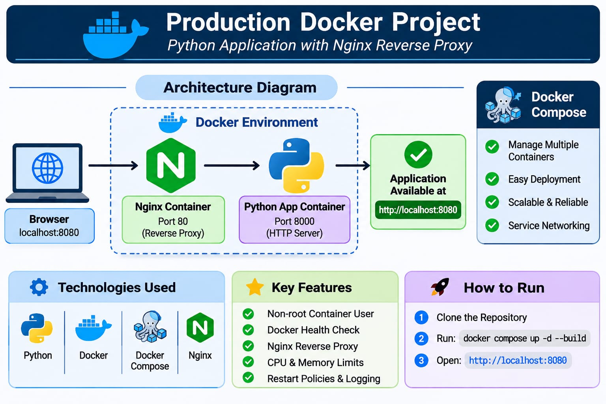
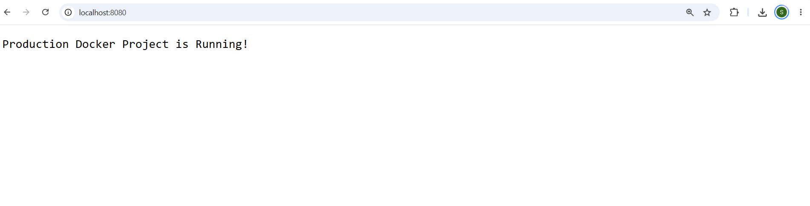

\# Production Docker Project

A Python application running inside Docker with Nginx as a reverse proxy.

\## Technologies Used

\- Python

\- Docker

\- Docker Compose

\- Nginx

\## Features

\- Non-root container user

\- Docker health check

\- Nginx reverse proxy

\- CPU and memory limits

\- Restart policies

\- Container logging

## Architecture Diagram

\## Run the Project

Start the application:

&#x20;   docker compose up -d --build

Open in browser:

&#x20;   http://localhost:8080

Stop the application:

&#x20;   docker compose down

## Application Output

